```{r setup, include=FALSE}
library(tidyverse)
knitr::opts_chunk$set(echo = TRUE, message = FALSE, warning = FALSE, collapse = TRUE, fig.align = 'center')
```


## Sobre mi

.pull-left[
- Ingeniero en Informática

- Máster y Doctorado en Informática con énfasis en aprendizaje automático

- Trabajando como ingeniero de aprendizaje automático (antes [ICMAT-CSIC](https://www.icmat.es/), ahora [Komorebi](https://komorebi.ai/))

- Podéis encontrarme en [Linkdin](https://www.linkedin.com/in/albertotb/), [Twitter](https://twitter.com/albertotba) o [Github](https://github.com/albertotb)

- Email: [albertotb@gmail.com](mailto: albertotb@gmail.com) 
]

.pull-right[
.center[


]
]

---

## Contenidos

.pull-left[
1) Conceptos:
  
  - Big data

  - Ciencia de datos (*data science*)

  - Inteligencia Artificial
  
  - Aprendizaje automático (*Machine Learning*)

  
2) Aplicaciones

  - ¿Dónde se está usando actualmente el aprendizaje automático con éxito?
  
  - ¿Dónde no funciona tan bien?

3) Nuevos modelos y tendencias

]


---

class: inverse, middle, center

## ¿Qué es el Big Data?

---

## Big Data

.content-box-red[
.bolder[Big Data]: conjuntos de datos tan grandes y complejos que precisan de aplicaciones informáticas no tradicionales de procesamiento de datos para tratarlos adecuadamente
]

- Definición no muy precisa. **Problemas**:

  - El software evoluciona
  
  - El hardware evoluciona


- Término general (**umbrella term**) para designar cualquier herramienta o aplicación relacionada con el análisis de **datos**

- **Marketing**!: el *big data* está (o estuvo) de moda

---

## ¿Cuánto es grande?

- Según Hadley Wickham (Big Data Pipelines, Febrero 2015), con la capacidad de computación actual:

   1. **Big Data**: no cabe en memoria de un único ordenador (~ Terabytes)

   2. **Medium Data**: cabe en la memoria de un servidor (10 GB – 1 TB)

   3. **Small Data**: cabe en la memoria de un portátil convencional (< 10 GB)
   
--

![:vspace 8]

.content-box-green[
.Large[
Espejismo del **Big Data**: más del 90% de los problemas actuales están en el rango de *small*-*medium* data
]
]

---

## Encuesta: conjunto de datos más grande analizado

.center[
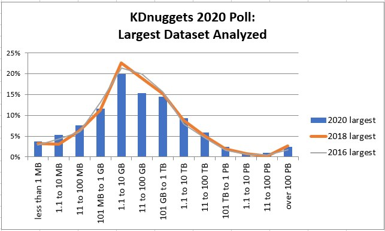

Fuente: KDnuggets. [Largest Dataset Analyzed](https://www.kdnuggets.com/2020/07/poll-largest-dataset-analyzed-results.html)
]

???

La mayoria de aplicaciones no se pueden considerar Big Data

Claramente necesitamos otros conceptos para describir el conjunto de técnicas que se usan para analizar esos conjuntos de datos


---

## El paraguas del **Big Data**

.center[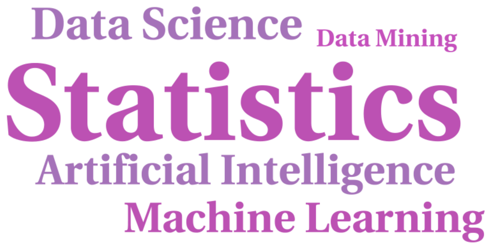]

- **Machine learning**, **pattern recognition** y **data mining** son prácticamente sinónimos
  
  - Cada uno de los términos fue popular durante diferentes épocas
  
  - Pequeñas diferencias en el énfasis: datos, modelos, aplicaciones 

- **Inteligencia Artificial** es el nuevo término de moda, pero tiene más de 60 años

???

Artificial Intelligence is not Machine Learning

Agents that can sense and interact with the world, learning from the experience. Usually complex systems, that contain more than one machine learning algorithms

Examples: robots, self-driving cars. Many sensors: lidar, cameras, ...


---

## Ciencia de datos (*data science*)

- Campo de estudio que ha ganado mucha popularidad en los últimos 5-10 años

- Todas las organizaciones tienen datos a explotar y estos crecen exponencialmente

- Mezcla de varias disciplinas "tradicionales":

  1. Estadística
  
  2. Matemáticas
  
  3. Ingenieria Informática
  
- Las herramientas se centran en tareas específicas y tienen (todavía) limitaciones: Excel (Microsoft), SPSS (IBM), SAS, Stata, Rapidminer, Weka, BigML

- Lenguajes de programación necesarios para realizar análisis de datos más complejos (Python, R)

---

## Los 6 componentes de la Ciencia de Datos

.pull-left[
1. Recolectar, preparar y explorar datos

2. Representación de los datos y transformación

3. Computación con datos

4. Visualizar y presentar datos

5. Modelado de datos: **machine learning**

6. Ciencia sobre la ciencia de datos
]

.pull-right[
.center[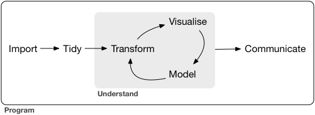]
]

Fuente: David Donoho. [50 years of Data Science](https://courses.csail.mit.edu/18.337/2015/docs/50YearsDataScience.pdf)

---

## 1. Recolectar y preparar datos

- A veces los datos no están disponibles de forma inmediata y es necesario recolectarlos (por ejemplo encuestas)

- Muchos proyectos se pueden ver beneficiados de añadir todavía más datos: Twitter, clima, conjuntos de datos públicos (censo, etc.)

- Los datos suelen estar en un formato "crudo": 

  - Contienen anomalías, artefactos, etc. que hay que eliminar

- **Muy importante**: explorar los datos y realizar comprobaciones para ver que se cumplen ciertas propiedades e hipótesis básicas


---

## 2. Representación y transformación de los datos

- Los datos a menudo provienen de distintas fuentes y están en formatos diversos: 

  - bases de datos
  
  - hojas de Excel
  
  - *streams* de datos continuos

- Algunos tipos de datos hay que transformarlos en números usando representaciones matemáticas especiales:
  
  - Imágenes
  - Video
  - Audio
  - Sensores
  - Texto

- Conclusión: transformar todas las fuentes a un formato común y unirlas

---

## 3. Computación con datos

- Muchísimas herramientas disponibles en el mercado

- A menudo son necesarios conocimientos de un lenguaje de programación (por ej. R o Python)

- Temas relacionados con la eficiencia computacional

- Múltiples paradigmas para escalar el cómputo a conjuntos de datos masivos:

  1. Computación en la nube
  
  2. Computación en un clúster
  
  3. Computación en paralelo

---

background-image: url(img/big_data_landscape.png)
background-size: contain

---

## 4. Presentación y visualización de datos

.pull-left[
Algunos ejemplos:

- Gráficos para explorar datos

- *Dashboards* para monitorizar procesos de datos

- Visualizaciones para sacar conclusiones de los modelos
]

.pull-right[

]

---

## 5. Modelado de datos

- Tradicionalmente el foco de los programas académicos

- Dos *culturas*:

  1. **Modelado generativo**: asumimos el proceso que genera los datos es conocido, establecer propiedades del mecanismo (estadística)
  
  2. **Modeloado predictivo**: énfasis en predicción, el mundo real es muy complejo y el proceso que genera los datos es desconocido (aprendizaje automático) 

- Más adelante hablaremos de modelos estadísticos sencillos y como aplicarlos en la práctica

---

## 6. Ciencia sobre la ciencia de datos

- Identificar análisis comunes o flujos de trabajo y medir su eficiencia en términos de:

  1. Tiempo
  
  2. Recursos computacionales
  
  3. Validez

- Descubrir patrones emergentes, por ejemplo artefactos en resultados de análisis publicados

- Crear estándares, diseño de herramientas

---


class: middle, inverse, center

# ¿Qué es la Inteligencia Artificial?


???

Es un término que vemos constantemente en los medios de comunicación, por ejemplo:

---

class: inverse, center

.rotate-left[
.border[

]]
--

![:vspace 2]

.rotate-right[
.border[
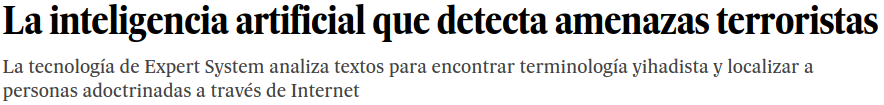
]
]

--
![:vspace 2]
.rotate-left[
.border[

]
]
--

![:vspace 2]
.rotate-right[
.border[

]
]

???

A que nos referimos con IA?

No estamos hablando de robots con inteligencia similar a la de los humanos

Estamos hablando de algoritmos de aprendizaje automático


---

class:center, middle

.huge[
.content-box-green[
.bolder[Inteligencia artificial]: técnicas que permiten que las máquinas perciban el entorno y usen aprendizaje para realizar acciones que maximicen las probabilidades de conseguir determinados objetivos
]
]

.huge[
.content-box-blue[
.bolder[Aprendizaje automático]: conjunto de técnicas que permiten que los ordenadores .bold[aprendan] de forma autónoma
]
]

???

Un robot que interactua con el entorno, toma decisiones yaprende de forma autónoma con nuevas experiencias

Muy probablemente el robot cuenta con sensores que toman imágenes, imitando a los ojos de los humanos

Estas imágenes son procesadas por múltiples algoritmos de aprendizaje automático, por ejemplo para detectar si hay un obstáculo o no

Hay inteligencias artificiales que no tienen nada que ver con aprendizaje automático, por ejemplo una máquina que aprenda a jugar al tres en raya

Si es verdad que en la práctica las aplicaciones más impresionantes de la IA involucran de una forma u otra algoritmos de ML


---

# Definición clásica vs actual

Puntos clave

- Razonamiento
- Planificación 
- Aprendizaje
- Toma de decisiones

En la actualidad:

Por ejemplo, de [Google](https://cloud.google.com/learn/what-is-artificial-intelligence?hl=en):

"Artificial intelligence (AI) is a set of technologies that enable computers to perform a variety of advanced functions, including the ability to see, understand and translate spoken and written language, analyze data, make recommendations, and more."


---

# Inteligencia artificial general (AGI)

Máquina que posee una inteligencia que le permita aprender y realizar cualquier tarea intelectual con un nivel similar al de los humanos


Es el objetivo de algunas empresas dentrás de algunos de los avances más importantes de los últimos años: [Planning for AGI and Beyond](https://openai.com/index/planning-for-agi-and-beyond/)

Algunos investigadores consideran que los modelos actuales son suficientes y únicamente es una cuestión de escala. [Scaling Laws for Neural Language Models](https://arxiv.org/abs/2001.08361)

---

# Breve historia


- 1956 - 1974: definición y primeros modelos

- 1974 - 1987: sistemas expertos

- 1987 - 2005: desarrollo del aprendizaje automático

- 2005 - 2012: Big Data

- 2012 - 2019: la revolución de la visión por computador

  - Competición ImageNet
  
  - Deep Learning

- 2020 - actualidad: la revolución del procesamiento de lenguaje natural

  - Modelos generativos
  
  - Grandes modelos de lenguaje

---

class: center, middle, inverse

# ¿Que significa aprender?

???

en este contexto, que significa aprender?


---

class: center

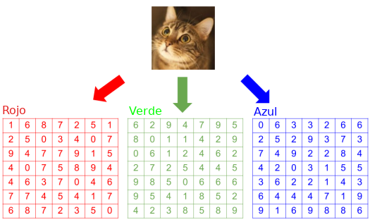

--

![:vspace 10]

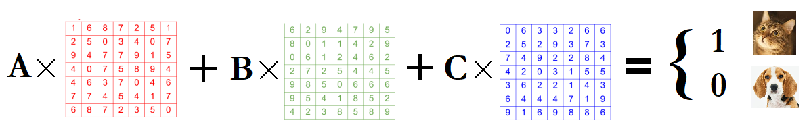

???

Aprender puede ser capaz de distinguir imágenes de gatos

Un ordenador no es capaz de ver la imagen de la misma forma que un humano

Entiende la imágen mediante números, que representan para cada pixel la intensidad de los colores rojo verde y azul 


Lo que hacen estos algoritmos es resolver ecuaciones, que permitan identificar cuando una imágen es de un gato o no

Para ello son necesarias un montón de imágenes con ejemplos gatos, donde sabemos que la ecuación tienen que valer 1, y también imágenes de otros objetos, donde vale 0


---

class: center, middle, inverse

## Aprender: transformar datos en reglas

???

Por tanto, en este tipo de técnicas podríamos decir que aprender (entre comillas) es transformar datos, por ejemplo imágenes, en reglas (que se representan como ecuaciones matemáticas)

Ademas de para detectar gatos, para que se puede usar un sistema como este?

---

## Resumiendo

- De la Wikipedia:

> Machine learning is a subfield of **computer science** that evolved from the study of **pattern recognition** and computational learning theory in artificial intelligence. In 1959, Arthur Samuel defined machine learning as a “Field of study that gives computers the ability to learn without being "**explicitly programmed**". Machine learning explores the study and construction of algorithms that can learn from and make predictions on **data**.

- Es decir:

  - Aprender la relación entre **entradas** y **salidas** a partir de los **datos**, de forma automática

  - Esta relación tiene una **formulación matemática** precisa, se aprenden los **parámetros** de la formulación

  - Nos permite hacer **predicciones** para nuevos datos

---

## Aprendizaje automático vs programación tradicional

1. Programación


2. Aprendizaje automático


.footnote[
[Fuente](https://www.logianalytics.com/predictive-analytics/machine-learning-vs-traditional-programming/)
]

---

class: center, middle

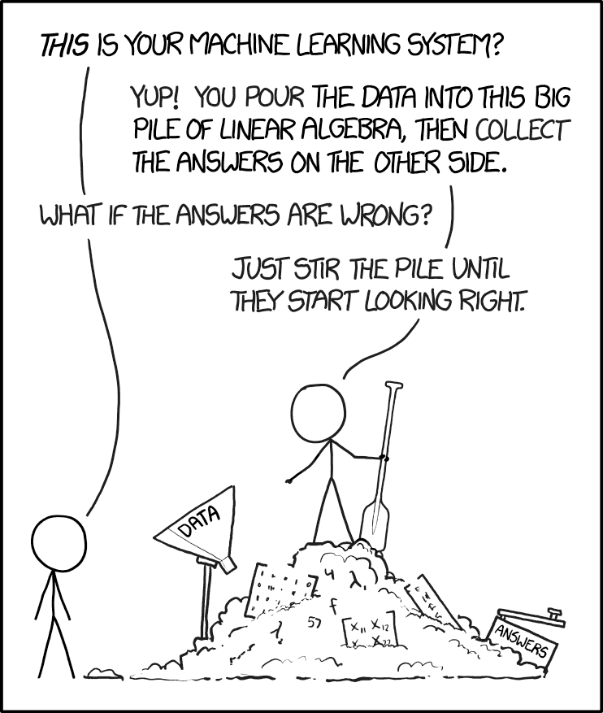

Fuente: [xkcd #1838](https://xkcd.com/1838/)


???

In practice, machine learning borrows heavily from engineering

Lots of trial and error

Software quality has improved a lot in the last years, a novice can train very complex models without deep knowledge of the underlying mathematical formulation

---

class: center, inverse, middle

# Casos de éxito del aprendizaje automático

---

## Sistemas de recomendación

- Los sistemas de recomendación son muy comunes: Netflix, Amazon, Google, ...

  - En 2009 Netflix creó una competición [competition](https://www.netflixprize.com/) para mejorar el rendimiento de su recomendador de películas
  
  - Un equipo de investigadores de AT&T ganó el premio de 1M de dólares

- Más información: [Google](https://sites.google.com/view/understand-ai-ml/success-stories), [Nvidia](https://www.nvidia.com/en-us/deep-learning-ai/customer-stories/)

---

.center[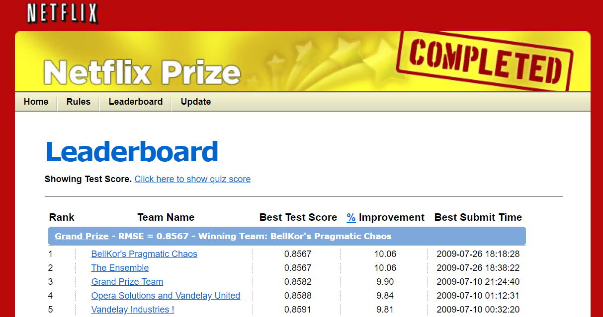]

---

## Visión por computador

- Los datos que alimentan los algoritmos son imágenes o video (secuencia de imágenes)

- Multiples tareas, se reducen a dos generales:

  1. Detectar objetos dentro de la imágen
  
  2. Clasificar imágenes ([demo de 1993](https://www.youtube.com/watch?v=FwFduRA_L6Q))
  
  .center[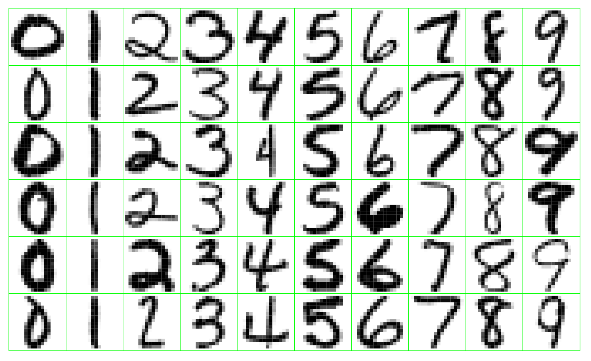]

---

## Detección de objetos

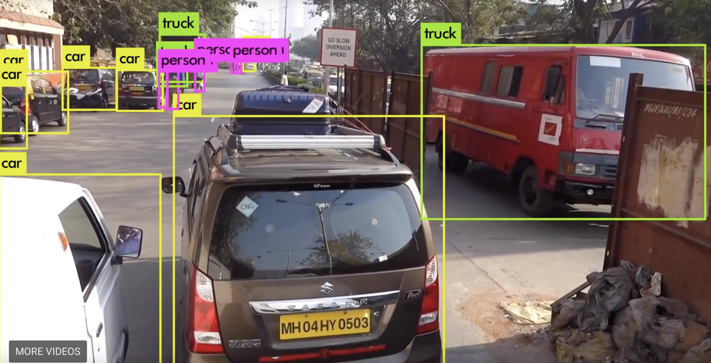

.small[Redmon, J., Divvala, S., Girshick, R., & Farhadi, A. (2016). You only look once: Unified, real-time object detection. In Proceedings of the IEEE Conference on Computer Vision and Pattern Recognition (pp. 779-788).]

---

## Segmentación de objetos

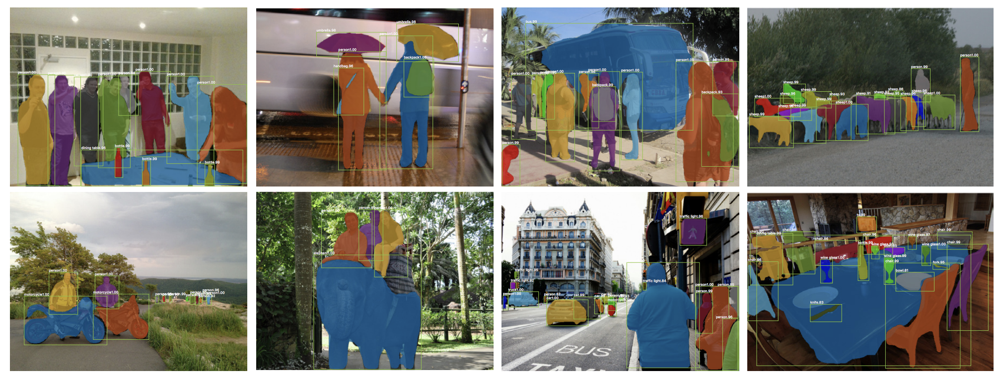

.small[He, Kaiming, Georgia Gkioxari, Piotr Dollár, and Ross Girshick. "Mask R-CNN." In Proceedings of the IEEE International Conference on Computer Vision, pp. 2961-2969. 2017]

---

## Detección de caras


.center[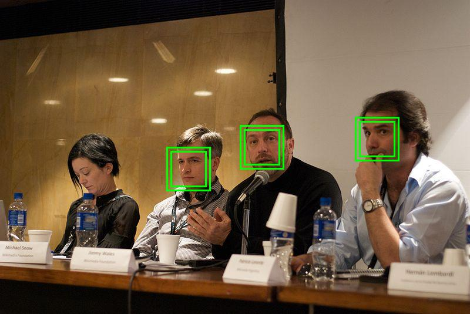

.footnotesize[[Wikipedia. Face detection](https://en.wikipedia.org/wiki/Face_detection)]
]

---

## Transferencia de estilo

.center[
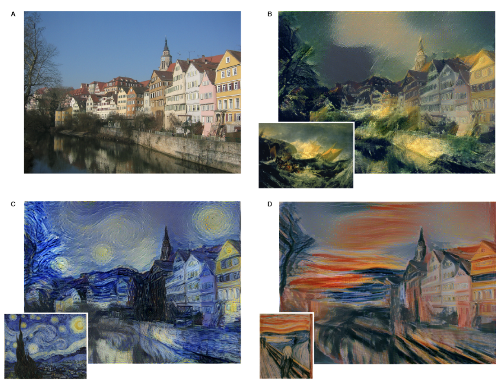
]

.small[Gatys, Leon A.; Ecker, Alexander S.; Bethge, Matthias. Image style transfer using convolutional neural networks. En Proceedings of the IEEE conference on computer vision and pattern recognition. 2016. p. 2414-2423.]

---

## Colorear imágenes

.center[
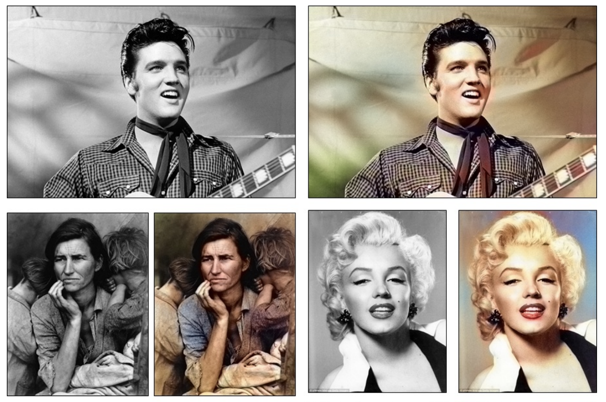
]

---

## Coches autónomos

.pull-left[
- Todavía quedan bastantes años para vehículos 100% autónomos

- Existen distintos grados de automatización ya en el mercado:

  - asistencia al aparcar
  
  - detección de cambios de carril
  
  - AutoPilot de Tesla
]

.pull-right[
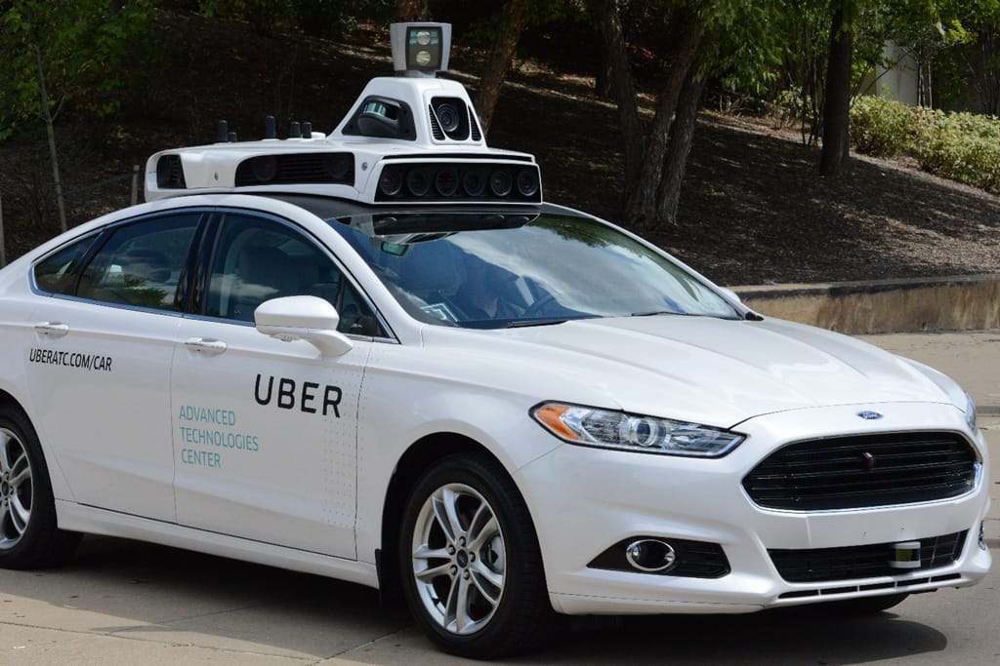
]

- Problemas importantes como el tráfico denso o condiciones climáticas desfavorables

- Múltiples sensores: cámaras, LiDAR, radar.

- Múltiples algoritmos de aprendizaje automático: en su conjunto probablemente podamos hablar de IA

---

## Super resolución

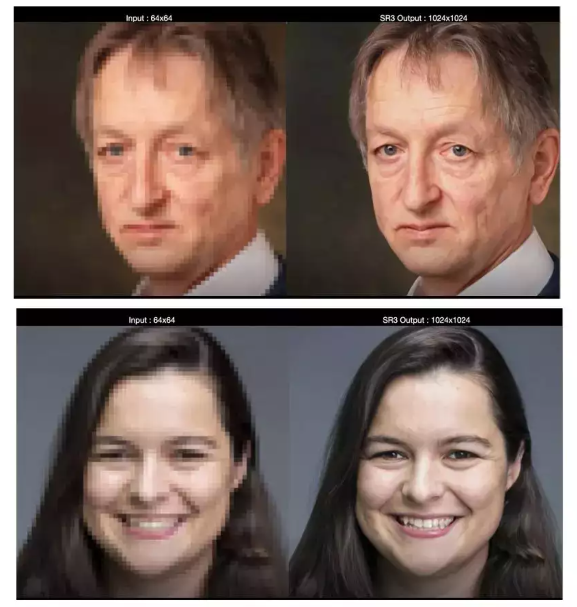

---

## Generación de imágenes y videos

  - [ThisPersonDoesNotExist](https://thispersondoesnotexist.com/)
  
.center[


.footnotesize[[Fuente](https://www.businessinsider.com/deepfake-tech-create-fictitious-faces-cats-airbnb-listings-2019-2)]
]

  - [Demo algo más realista](https://www.youtube.com/watch?v=AmUC4m6w1wo)

---

## Análisis de imágenes médicas

  - Ayudar a los médicos a diagnosticar distintas enfermedades a partir de distintas fuentes de datos, por ejemplo imágenes de rayos X
  
  - También se pueden analizar automáticamente otro tipo de imágenes, como microscopia (células)
  
.pull-left[


.footnotesize[[Google AI Blog (2019). Developing Deep Learning Models for Chest X-rays with Adjudicated Image Labels](https://ai.googleblog.com/2019/12/developing-deep-learning-models-for.html)]
]

.pull-right[
    

.footnotesize[[PMFarma (2014). FotoSkin, app gratuita que ayuda al diagnóstico precoz del cáncer de piel](http://www.pmfarma.es/noticias/18574-fotoskin-app-gratuita-que-ayuda-al-diagnostico-precoz-del-cancer-de-piel.html)]
]

---

## Eliminación de fondo


---


Por ejemplo [esta](https://www.remove.bg/upload) web

---
  
## Procesamiento de lenguaje natural

- Los datos que alimentan los algoritmos son principalmente textos

- Ejemplos de tareas:
    
    - Clasificación de textos
    
    - Extracción de información
  
    - Generación de textos
  
    - Respuesta de preguntas
    
    - Chatbots
    
    - Traducción automática
    
    - Resumen de textos


---

## Clasificación de textos

- Spam / no spam

- Temáticas: importante, promociones, etc.

- Análisis de sentimiento: positivo/negativo


---

## Extracción de información

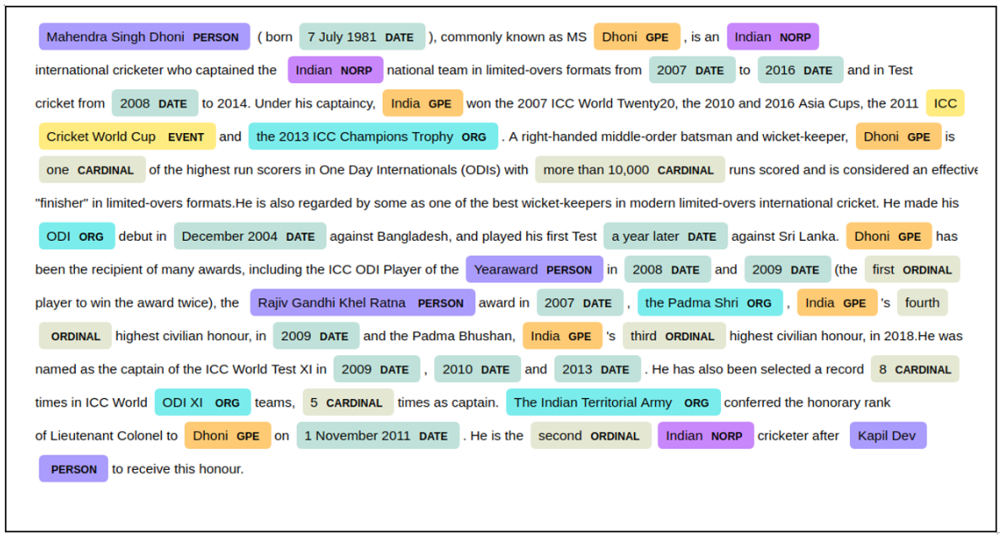

---

## Respuestas a preguntas

.center[
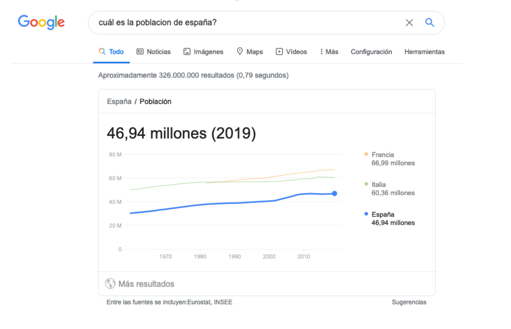
]


---

## Generación de textos

- El mayor modelo de lenguaje actualmente es GPT-4 de OpenAI. Comparación rápida GPT-3 vs GPT-4

  - Parámetros: 175.000 millones vs 1.76 trillones (10x)
  
  - Datos de entrenamiento: 45 TB (45,000 GB)

- Se estima que el coste de entrenar GPT-4 fue de alrededor 100M de dólares: 10,000 tarjetas gráficas funcionando continuamente durante 11 meses

- Microsoft tiene ya [herramientas](https://1gew6o3qn6vx9kp3s42ge0y1-wpengine.netdna-ssl.com/wp-content/uploads/prod/sites/3/2021/05/GPT-3-Power-Fx-MP4-v2-1.mp4?_=1) basadas en modelos de lenguaje, por ejemplo para generar fórmulas de Excel a partir de texto natural o código fuente (Copilot)

---

## Traducción automática


* [**Google Traslate**](https://ai.google/research/pubs/pub45610)

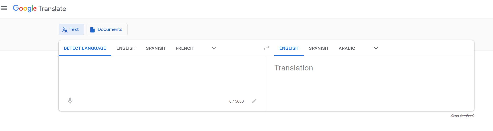

---

## Reconocimiento de voz

.pull-left[

- Voz a texto

- Texto a voz
]

.pull-right[
- Reconocimiento de locutor

- Clasificación de audio
]


![:vspace1 30]

.pull-left[
.center[

]
]

.pull-right[
.center[


.footnotesize[[Fuente](https://www.theguardian.com/small-business-network/2016/dec/07/shazam-co-founder-we-were-growing-a-business-in-a-collapsing-market)]
]
]

---

## Ejemplos

- Shazam/reconocimiento de canciones

- Transcripción de audio a texto, por ej. generación automática de subtítulos

---

## AlphaGo y AlphaFold

  - Programa de ordenador que ganó al juego Go contra Lee Sedol (18 veces campeón del mundo) en 2016

  - Técnicas similares se están usando para descubrir nuevas proteinas

.center[
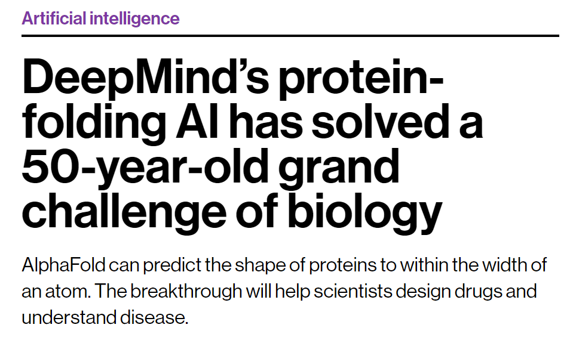

.footnotesize[[Fuente](https://www.technologyreview.com/2020/11/30/1012712/deepmind-protein-folding-ai-solved-biology-science-drugs-disease/)]
]

---

## Dota2

  - [OpenAI Five](https://openai.com/projects/five/) es un algoritmo que juga a Dota2, un juego de ordenador por equipos (5 vs 5)
  
  - En 2019 ganó 2-0 contra el equipo campeón del mundo de DOTA2
  
  - 99% de victorias contra múltiples equipos amateur

.center[
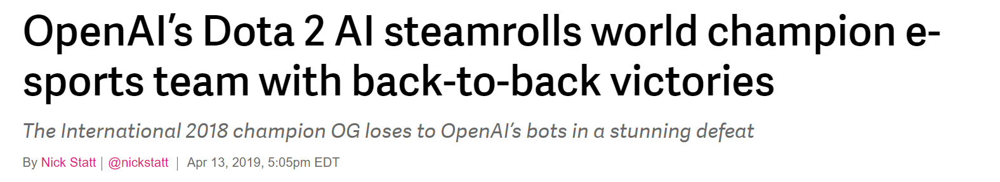

.footnotesize[[Fuente](https://www.theverge.com/2019/4/13/18309459/openai-five-dota-2-finals-ai-bot-competition-og-e-sports-the-international-champion)]
]


---

## ¿Cuándo no funciona el aprendizaje automático?


En general, la aplicación (exclusivamente) de algoritmos de aprendizaje automático es complicada si:

- No hay relación entre las entradas y salidas

- La aplicación específica presenta problemas éticos

- No hay suficientes datos de calidad disponibles

- No podemos definir una métrica para cuantificar el éxito

- Se necesita una explicación detallada de las decisiones tomadas

- No hay tolerancia para errores

???

- Incluso si hay correlación. Ejemplo: correlación entre venta de helados y ataques de tiburones. Podemos hacer un modelo que prediga los ataques de tiburones? Posiblemente. Es un bueno modelo? Probablemente no

- La idea de confiar en datos y algoritmos más que en nuestro propio juicio tiene pros y contras. Quien tiene la culpa si algo va mal?
  
  - Coches autónomos
  - ML en medicina
  - ML en el sistema judicial
  
- Si el coche autónomo mata a una persona en un accidente, de quien es la culpa

  - Conductor
  - Ingenieros que diseñaron el algoritmo
  - Personas que usaron el algoritmo en ese coche en concreto

- ML funciona muy bien cuando podemos definir el objetivo de forma precisa, aunque no se conozca el proceso para alcanzar dicho objetivo. Métricas específicas a optimizar que capturan bien la solución del problema

- Referencias:
 
 - https://www.getfilecloud.com/blog/2018/06/top-5-limitations-of-machine-learning-in-an-enterprise-setting/
 - https://towardsdatascience.com/the-limitations-of-machine-learning-a00e0c3040c6
 - https://medium.com/mit-initiative-on-the-digital-economy/what-machine-learning-can-and-cannot-do-6788a818776

---

class: center, inverse

.border[
.center[

]
]

--

![:vspace 10]

.border[

]


???

Esta tecnología también conlleva nuevos riesgos que tenemos que anticipar

Por ejemplo, os imaginais lo que podría pasar si el coche no es capaz de detectar un peatón

Esto es lo que paso en 2016 en el primer accidente de un coche autónomo con victimas mortales

En este caso en concreto, el algoritmo no detecto el peatón correctamente

---

background-image: url(img/adversarial.png)
background-size: cover

![:vspace 95]

.tiny[[Thys, Van Ranst, Goedemé (2019). Fooling automated surveillance cameras: adversarial patches to attack person detection](https://arxiv.org/pdf/1904.08653.pdf)]

---

## Sesgos 

- Además de los problemas anteriores, relacionados con errores en el resultado, los modelos de ML pueden amplificar sesgos sociales

- Esto se debe en parte (pero no únicamente) a que replican los sesgos contenidos en los datos

- Si esos algoritmos se usan para tomar decisiones, estarán perjudicando a distintos grupos de población

- A veces estos sesgos pueden pasar desapercibidos porque los modelos no explican con detalle el por qué de sus predicciones

- Ejemplos:
  
  - algoritmo que toma la decisión de conceder un crédito o no
  
  - algoritmo que predice en que zonas se van a cometer más delitos

---

## Más ejemplos

- Modelo que reconstruye imágenes

- Hace que Obama sea blanco (en general, produce caras de personas blancas con más frecuencia)

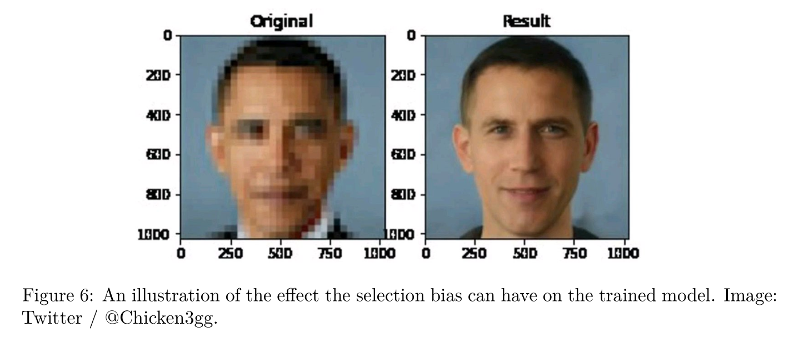

---

class: center

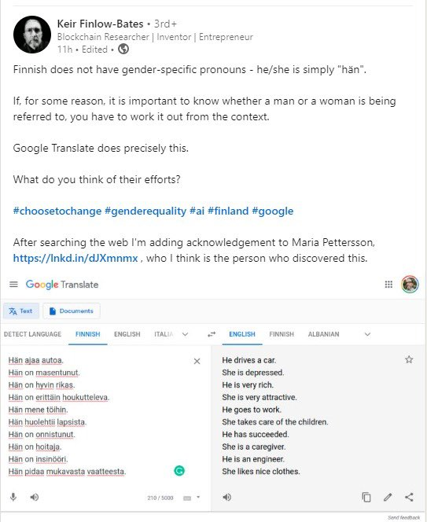

---

## Riesgos y seguridad

Existen potenciales riesgos con estas tecnologías, por ejemplo:

  - simplificar la generación de contenido malicioso, fake news o desinformación

  - automatización de ciertas profesiones
  
  - privacidad
  
Otros investigadores, apuntan también al potencial riesgo de la pérdida de control sobre una IA suficientemente avanzada, aunque no hay consenso

---

class: inverse, middle, center

# Más ejemplos de aplicaciones

---

Identificar factores de riesgo para el cáncer de próstata

.center[
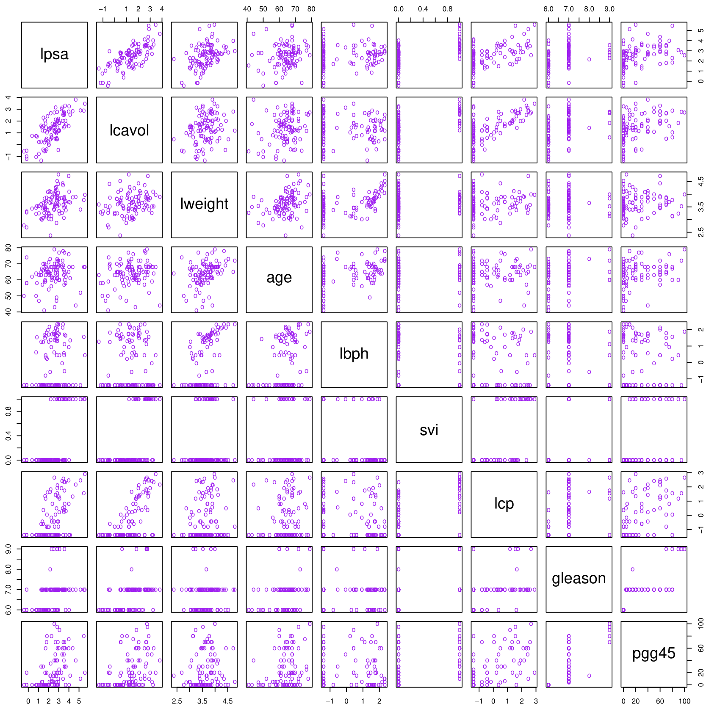
]

???

clinical measures
lpsa: prostate specific antigen

---

Predecir si una persona va a tener un ataque al corazón basado en variables demográficas, dieta y variables clínicas

.center[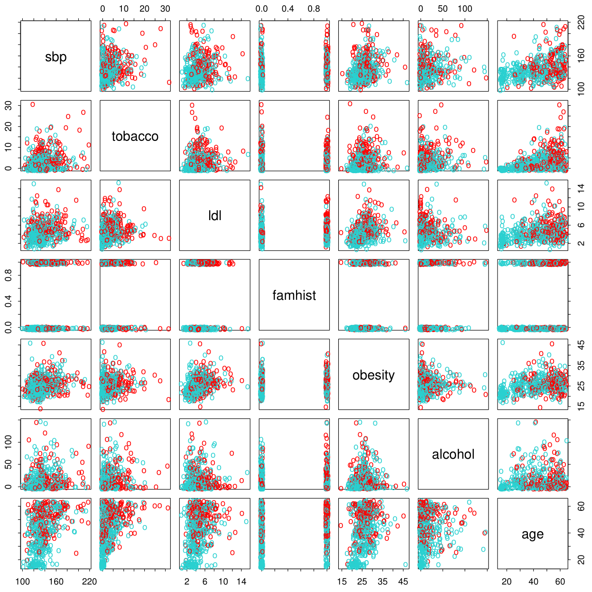]

---

Crear un filtro automático de detección de spam

- Datos de 4601 emails enviados a un empleado de HP labs (George)

- Etiquetados manualmente como .red[spam] o .green[email]

- Objetivo: crear un detector automático de spam

- Datos de entrada: frecuencias relativas de las 57 palabras más frecuentes y signos de puntuación

.center[
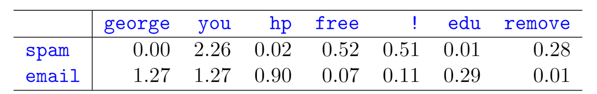
]

---

Establecer la relación entre salario y variables demográficas usando datos de encuestas

.center[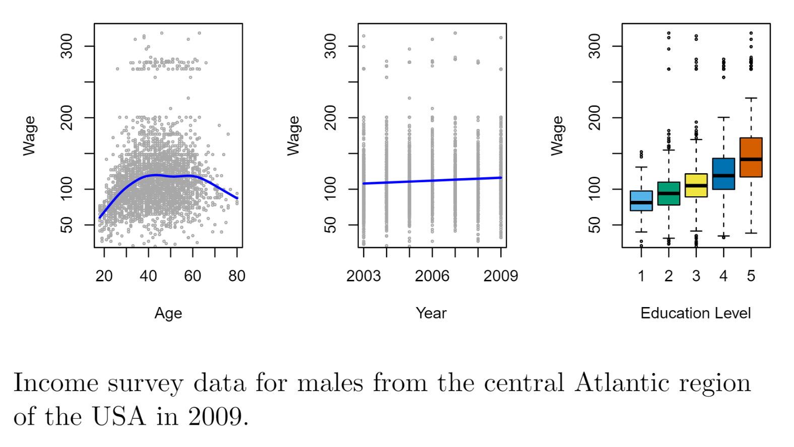]

---

Clasificar los píxeles de una imágen satélite por uso de la tierra

.center[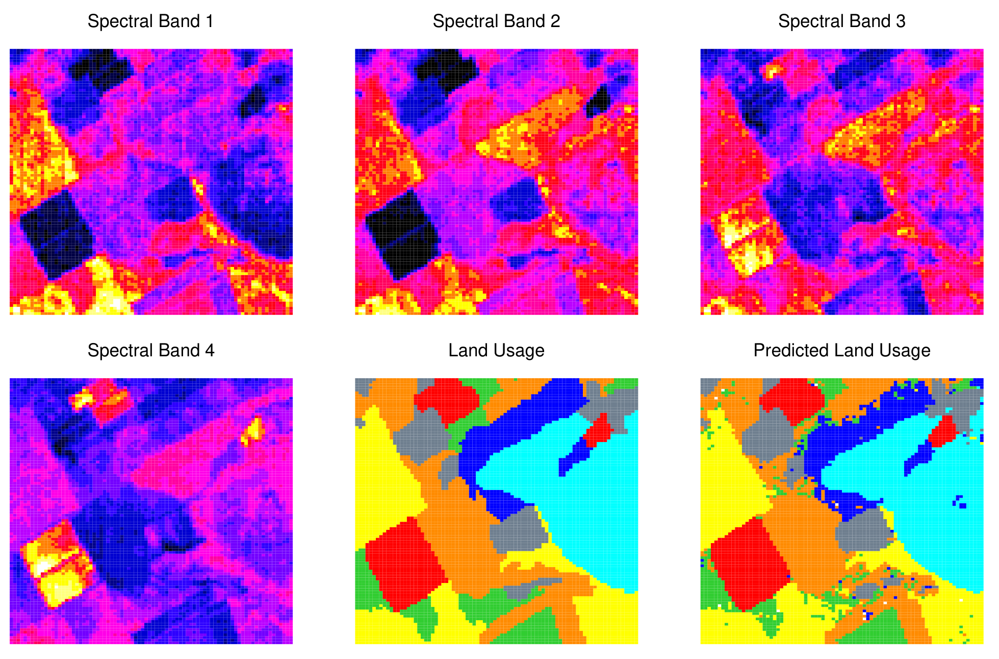]

El color codifica el tipo, por ejemplo *tierra*, *vegetación*, *tierra húmeda*, *uso agrario*, ...

---

class: inverse, center, middle

# Avances recientes

---

## Modelos de lenguajes

Los *Large language models* o LLMs son modelos de procesamiento de lenguaje natural entrenados para la generación de texto


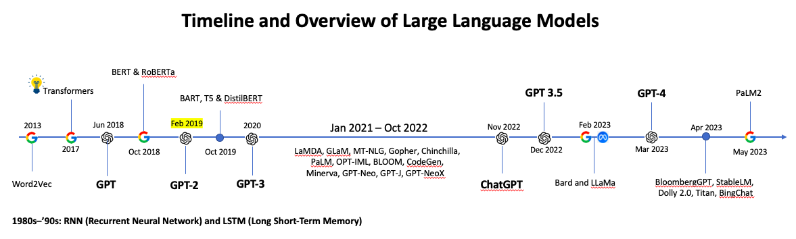

---

## ¿Cómo se entrena un LLM?

Predecir la siguiente palabra

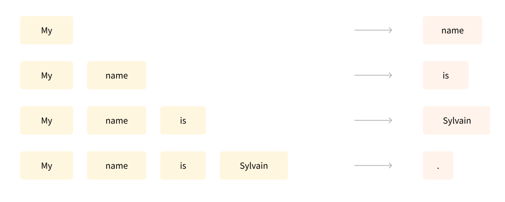

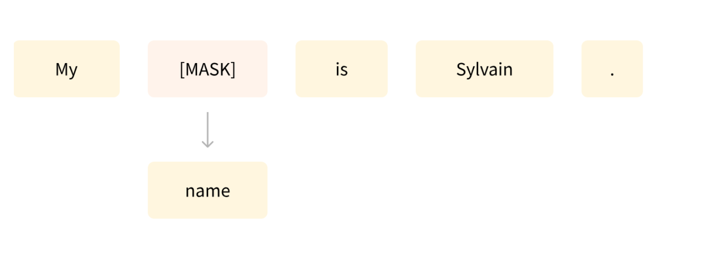


---

## ¿Cómo se alinea un LLM?

Los modelos de lenguaje se entrenan de forma no-supervisada con cantidades ingentes de texto

Son estocásticos, es decir, dado el mismo prompt pueden devolver distintas respuestas

Se puede entrenar un modelo por encima donde los humanos deciden que respuesta prefieren dentro de un conjunto (Reinforcement Learning From Human Feedback)

---

## Hipótesis de escala

Algunos investigadores creen que el camino hacia la inteligencia artificial general consiste en modelos más grandes

Está hipótesis se formuló por primera vez en [2020](https://arxiv.org/abs/2001.08361) y es el camino que siguen los principales modelos

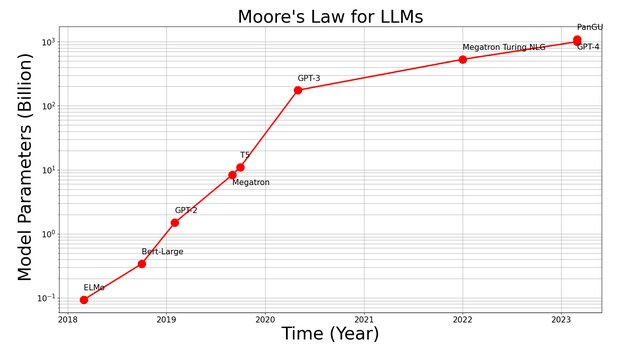

[Otra infografía a escala](https://www.reddit.com/r/Infographics/comments/1c81n2o/the_size_of_llms_apr_2024/#lightbox)


---

## Comparativa

[Chatbot Arena](https://lmarena.ai/?leaderboard)

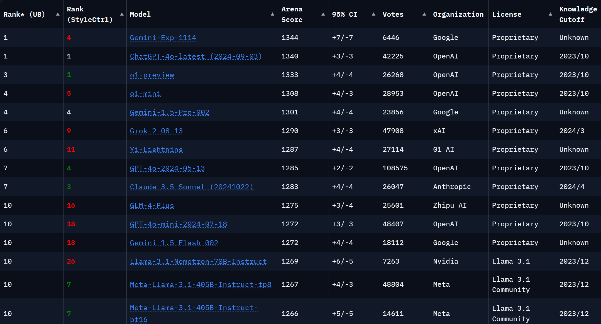
---

## Limitaciones

Otros [investigadores](https://arxiv.org/pdf/2409.14160) creen el paradigma actual de aumentar el tamaño de los modelos no es sostenible ni eficiente, debido al aumento del coste

[ARC-Challenge]( https://arcprize.org/. Benchmark diseñado para medir inteligencia, es decir, la capacidad de adquirir nuevas habilidades. El benchmark es sencillo para los humanos pero complicado para los modelos actuales. Se ofrece un premio de más de 1M de dólares por superar el 85%.

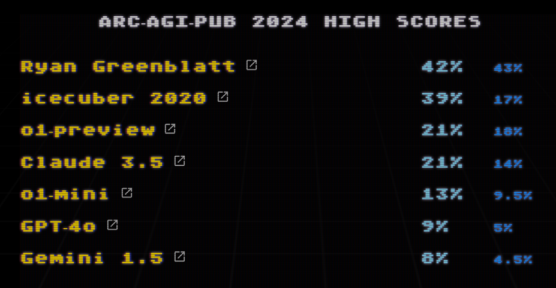

---

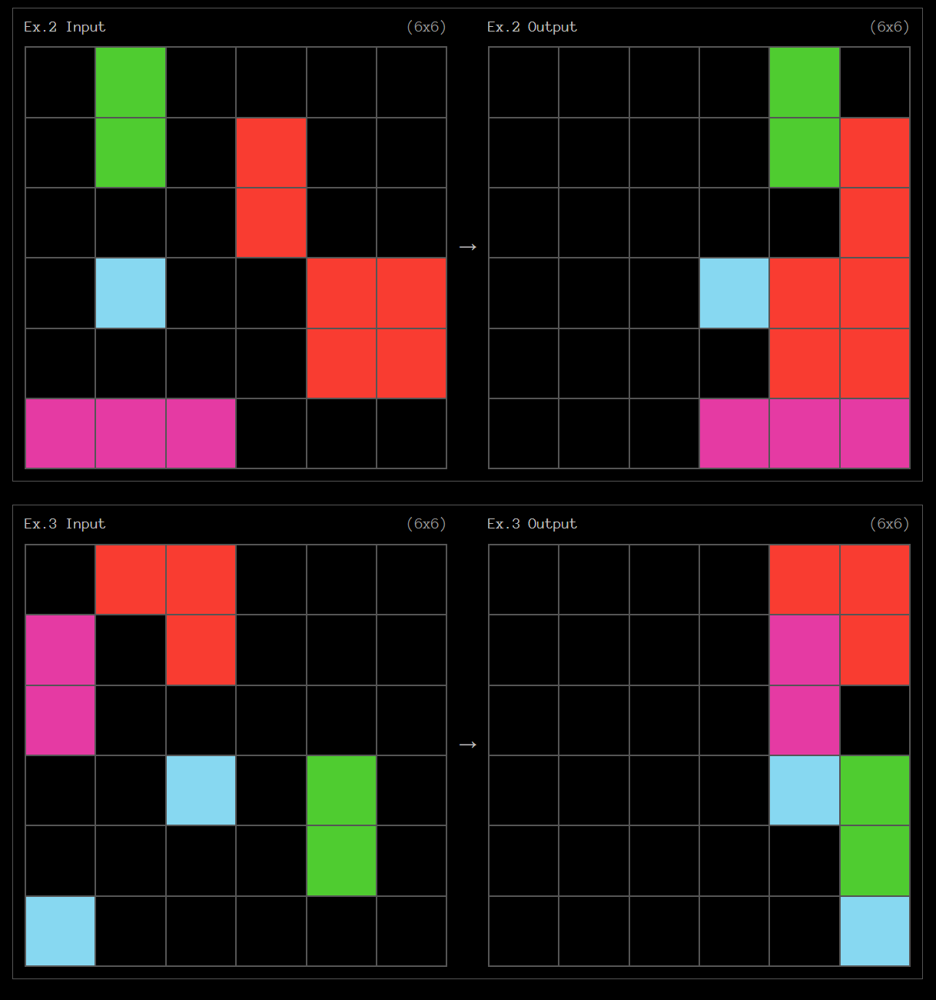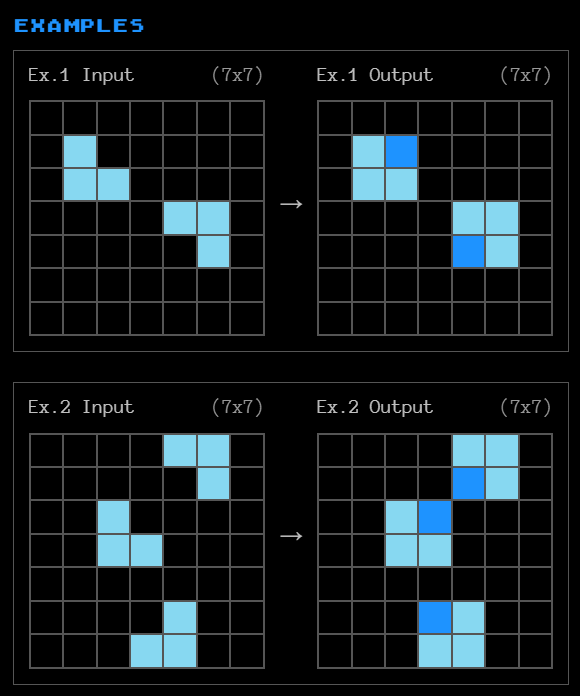


---

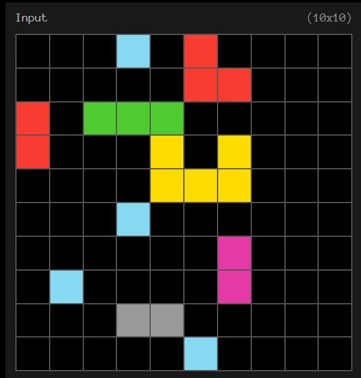

---

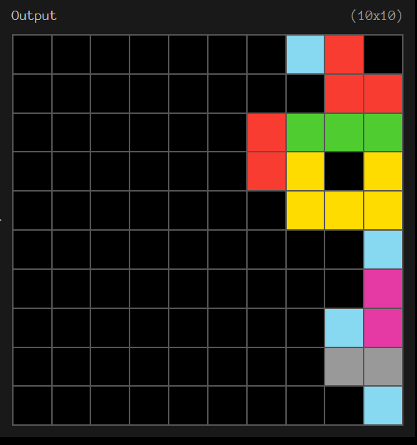

---

## Multi-modalidad

- Muchos de los modelos de "lenguaje" actuales son en realidad modelos multi-modales

- Esto quiere decir que aceptan como entrada tanto imágenes como texto

- El modelo convierte tanto el texto como las imágenes a una misma representación intermedia, desbloqueando nuevos casos de uso, por ejemplo
   
   - búsqueda semántica
   
   - generación de imágenes

---

class: inverse, center, middle

# Conclusiones

---

## Resumen

- Incorporar el uso de datos en los procesos de toma de decisión es cada ves más habitual (y solo va a crecer)

- Uno de las herramientas más populares para extraer conocimiento es el **aprendizaje automático** (big data o no)

- Todavía estamos lejos de una Inteligencia Artificial General:

  - capaz de razonar y tomar decisiones de forma similar a los humanos
  
  - en múltiples contextos que cambian
  
- Sin embargo, en problemas específicos el aprendizaje automático tiene resultados sorprendentes:

  - .green[Capaz de extraer patrones y crear reglas generales de una ingente cantidad de datos]
  
  - .green[Más rápido y eficiente]
  
  - .red[Incapaz de razonar y explicar sus predicciones]

---

## Referencias

1. Jerome H. Friedman. [Data Mining and Statistics: What's the Connection? (1998)](http://statweb.stanford.edu/~jhf/ftp/dm-stat.pdf)
   
2. Leo Breiman. [Statistical Modeling: The Two Cultures (2001)](http://projecteuclid.org/download/pdf_1/euclid.ss/1009213726)
   
3. Cross Validated. [What is the difference between data mining, statistics, machine learning and AI (2010).](http://stats.stackexchange.com/questions/5026/what-is-the-difference-between-data-mining-statistics-machine-learning-and-ai)
   
4. Sakthi Dasan Sekar. [What is the difference between Artificial Intelligence, Machine Learning, Statistics, and Data Mining (2014)](http://shakthydoss.com/what-is-the-difference-between-artificial-intelligence-machine-learning-statistics-and-data-mining/)
   
5. Cross Validated. [What exactly is Big Data? (2015)](http://stats.stackexchange.com/questions/173060/what-exactly-is-big-data)

6. Pedro Domingos. [A Few Useful Things to Know about Machine Learning (2012)](https://sites.astro.caltech.edu/~george/ay122/cacm12.pdf)

7. David Donoho. [50 Years of Data Science (2017)](https://www.tandfonline.com/doi/pdf/10.1080/10618600.2017.1384734?needAccess=true)